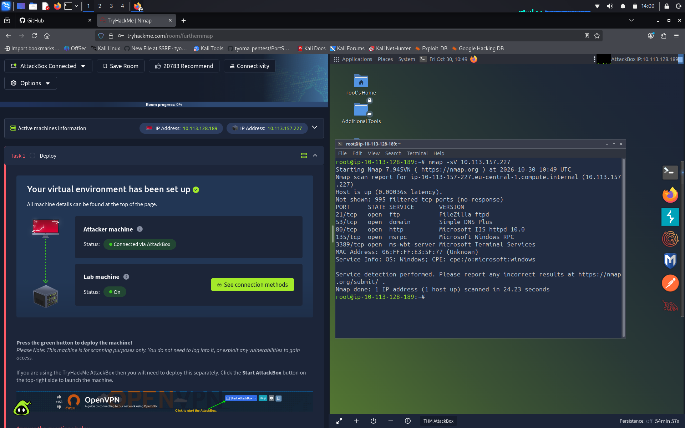

# TryHackMe: Nmap

**Платформа:** TryHackMe  
**Сложность:** Easy  
**Дата:** 30.10.2026

---

## 1. Описание комнаты
Комната посвящена базовому изучению утилиты `nmap` для сканирования сетей. Отработка флагов для разведки, определения ОС и обхода файрволов.

---

## 2. Ключевые команды, которые я изучил
- `nmap -sS` - SYN-сканирование (скрытное).
- `nmap -sV` - определение версий сервисов.
- `nmap -O` - определение ОС.
- `nmap -p-` - сканирование всех портов.
- `nmap --script=vuln` — запуск скриптов на поиск уязвимостей.

---

## 3. Ход выполнения
Запустил машину, получил IP `10.113.157.227`. Выполнил команду `nmap -sV 10.113.157.227`. Нашел открытые порты: 21 (FTP), 53 (DNS), 80 (HTTP), 135 (RPC), 3389 (RDP). Это позволило определить, что цель - Windows. Выполнил Xmas-сканирование (`-sX`), увидел, что файрвол блокирует пакеты (no-response).

\

---

## 4. Что я вынес
Понял, как использовать `nmap` для полноценной разведки. Научился сохранять результаты в разные форматы (`-oN`, `-oX`, `-oG`) и использовать NSE-скрипты.

---
