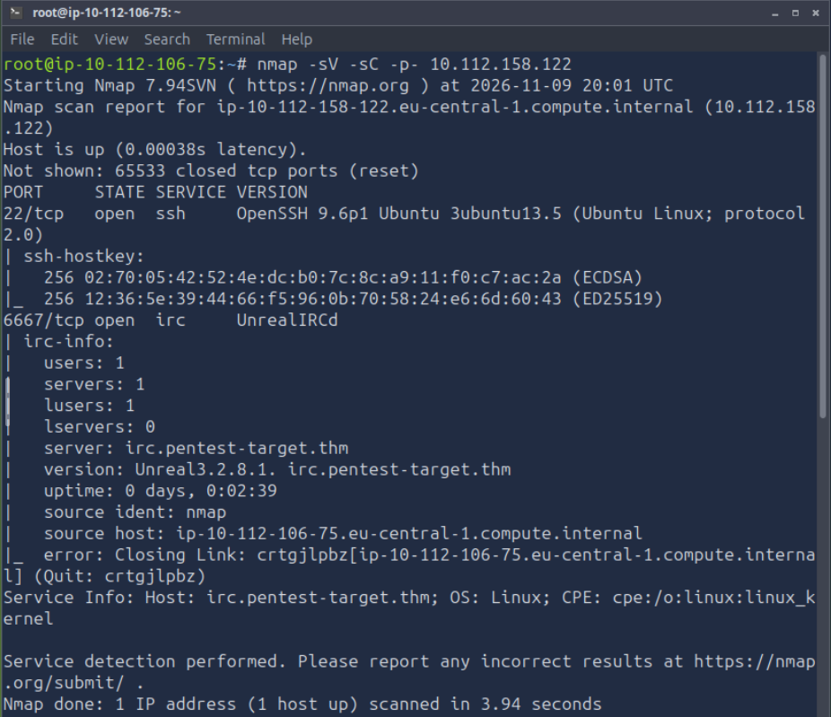

# TryHackMe: Guided Pentest - Infrastructure

**Платформа:** TryHackMe  
**Сложность:** Medium (требует базовых знаний)  
**Дата:** 09.11.2026

## 1. Описание комнаты
Эта комната — переход к полноценной методологии тестирования на проникновение. В ней показано, как собрать все "строительные блоки" воедино и провести полноценный аудит инфраструктуры (Infrastructure Pentest).

**Ключевая мысль:** Пентест — это не просто набор инструментов. Это образ мышления. Нужно думать как программист (где код сломается), как сисадмин (где ошибка в конфиге), как SOC-инженер (что заметит защита) и как злоумышленник (что можно пропустить).

---

## 2. Методология Infrastructure Pentest
Тестирование инфраструктуры (серверы, принтеры, фаерволы и др. устройства с сетевым интерфейсом) всегда строится по единому плану:

1. **Перечисление (Enumeration):** Начинаем с нуля. Что мы знаем о цели? Что нам еще нужно узнать? (Сбор портов, сервисов, версий ПО).
2. **Анализ уязвимости (Vulnerability Analysis):** Анализируем результаты разведки, сопоставляем версии ПО с известными CVE и ищем потенциальные слабые места.
3. **Первоначальный доступ (Initial Access):** Выбираем вектор атаки, эксплуатируем уязвимость и закрепляемся в системе.
4. **Эскалация привилегий (Privilege Escalation):** Мы уже внутри, но это не конец. Пересматриваем систему изнутри, ищем локальные уязвимости, SUID-бинарники или неправильные права доступа, чтобы стать `root`.
5. **Отчет (Reporting):** Без отчета вся предыдущая работа не имеет смысла. Нужно грамотно задокументировать найденные уязвимости и пути их устранения.

---

## 3. Цели обучения
В ходе выполнения комнаты я отработаю следующие навыки:
- Использование инструментов и методов для сканирования Linux-хостов.
- Исследование уязвимого ПО и поиск рабочих эксплойтов (под конкретные версии).
- Перечисление локальных файлов Linux и поиск путей для повышения привилегий (PrivEsc).

**Предпосылки:** Базовое понимание работы Metasploit и основ работы с командной строкой (навигация в терминале).

---

## 4. Разведка

Первое с чего я начал - это разведка. С помощью `nmap` я просканировал сеть:
`nmap -sV -sC -p- 10.112.158.122`  

Видим два открытых порта:
`22/tcp - ssh`  
`6667/tcp - irc` 
