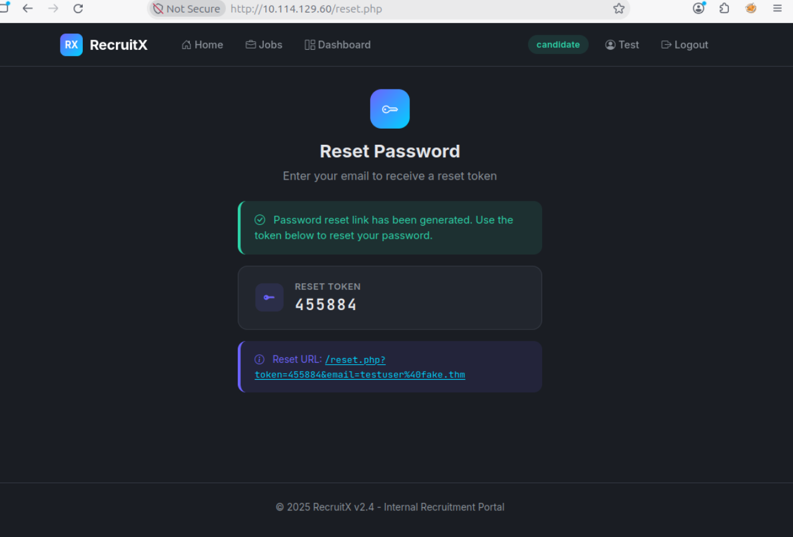
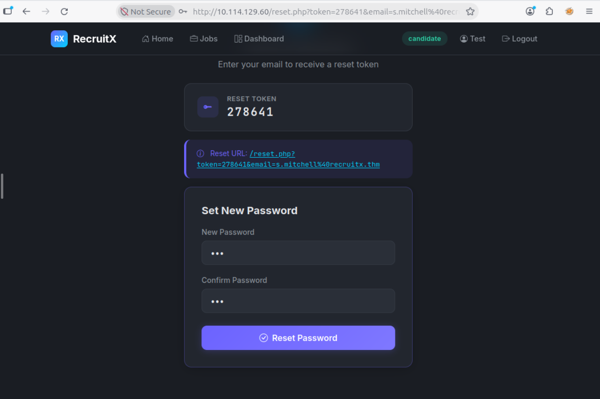
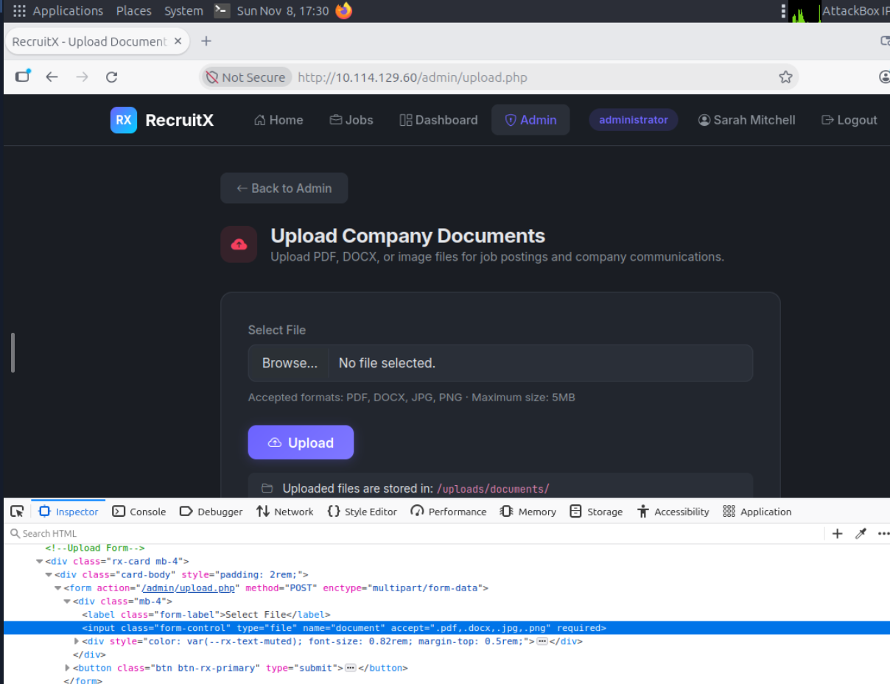
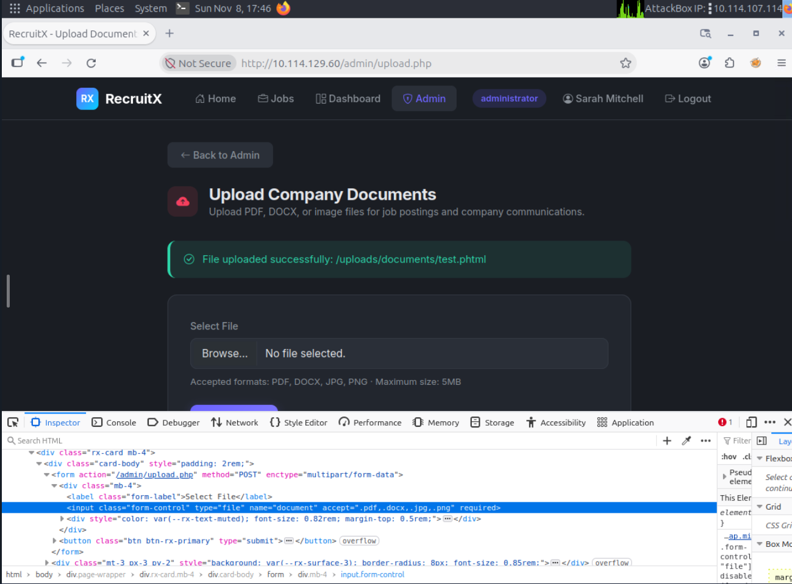

# TryHackMe: Guided Pentest: WEB

**Платформа:** TryHackMe  
**Сложность:** Easy  
**Дата:** 08.11.2026

## 1. Описание комнаты

Эта комната проведет через реалистичный тест на проникновение веб-приложения от начала до конца. Каждая задача проводит через этап взаимодействия, объясняя, что делать, почему вы это делаете и что искать. 

# 2. Разведка

Первое с чего я начал - разведка. С помощью `nmap` я провел разведку и нашел четыре открытых порта: 

`nmap -sV -sC -p- 10.114.129.60`  

После я получил такой вывод:

После этого я запустил `gobuster`: 

`gobuster dir -u http://10.114.129.60 -w /usr/share/wordlists/dirb/common.txt -k`

Я получил такой вывод (в нем показаны не все домены, так как просто не поместились). Далее я начал исследовать эндпоинт `/api/` через `curl`

## 3. Поиск уязвимостей

Далее я перешел на сайт, обратил внимание на ендпоинт `profile.php` и на то, как изменяется URL:

`http://10.114.129.60/profile.php?id=6` - это мой профиль, что будет если попробовать поменять значение `id`? Изменим его на **1**:  

Это смело можно назвать `IDOR` - один из наиболее распространенных и часто упускаемых из виду недостатков в веб-приложениях является **IDOR**, доступ к чужим данным.

## 4. Сброс пароля администратора

Нам также известно об эндпоинте `/reset.php`, зайдя на него я увидел что для сброса пароля необходимо ввести почту - токен приходит не на почту или еще куда то, а сразу показывается на сайте:

Если отправить форму запроса несколько раз - можно заметить, что токен исключительно шестизначный - от 000000 до 999999. Дальше я попробовал сбросить пароль администратора и установить новый, что получилось без проблем:

## 5.

Дальше, исследую админскую панель, я обратил внимание на эндпоит `upload.php`. `Upload -> Inspect`: Тут ограничиваются типы файлов которые можно загрузить, но это только со стороны клиент. Также, файлы находяться в эндпоинте `/document`:

Далее я создал два файла. Первый - `test.php`, второй - `test.phtml`. Каждый содержал одиннаковый текст: `<?php echo "PHP is cool" ?>`. После попробовал загрузить их на сайт, получилось загрузить только файл `test.phtml`:

