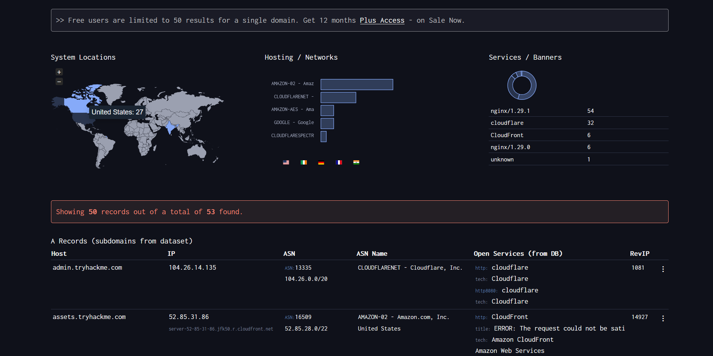
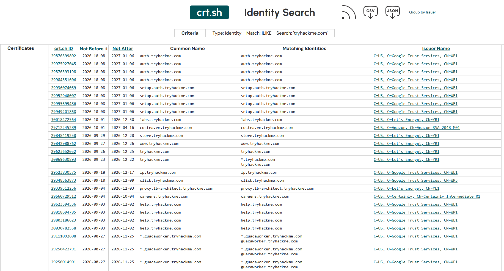
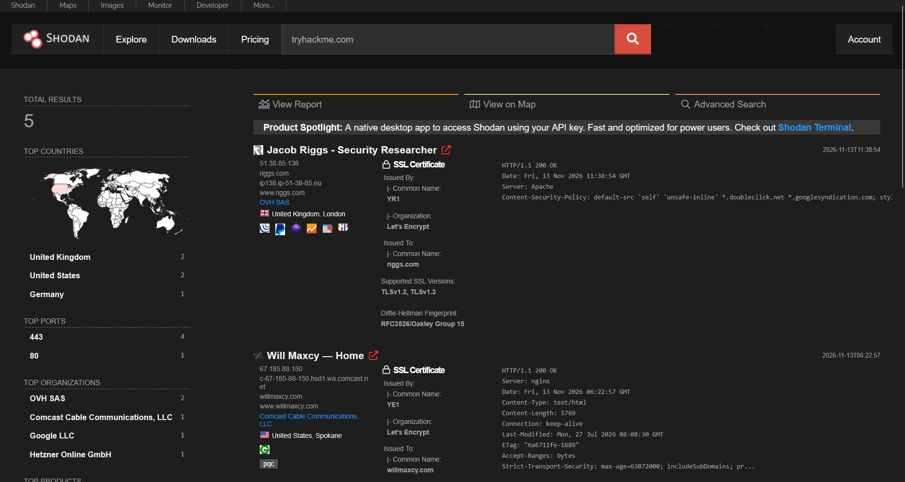
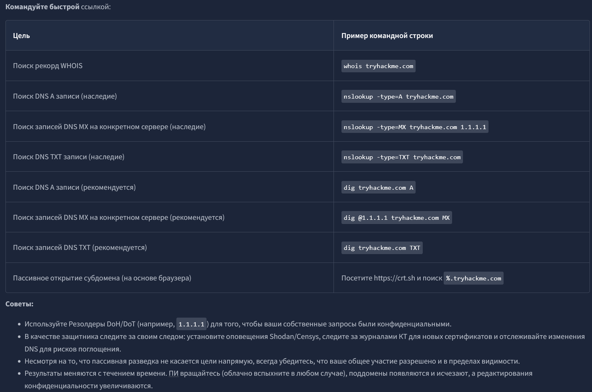

# TryHackMe: Passive Reconnaissance

**Платформа:** TryHackMe  
**Сложность:** Easy  
**Дата:** 13.11.2026

## 1. Описание комнаты

Комната посвящена пассивной разведке (Passive Reconnaissance). В отличие от активного сканирования (например, Nmap), пассивная разведка не отправляет пакеты напрямую на серверы цели. Мы используем публичные данные и сторонние сервисы, что делает нас невидимыми для систем обнаружения вторжений цели.

## 2. WHOIS и DNS

Пассивная разведка начинается с получения базовой информации о домене.

**WHOIS:** Позволяет узнать регистратора домена, дату регистрации, контактные данные владельца и авторитетные DNS-серверы. 
*Примечание:* Многие регистраторы скрывают данные владельца через сервисы приватности.

**DNS (Domain Name System):** «Телефонная книга» интернета. Мы запрашиваем записи у публичных резолверов (например, Cloudflare `1.1.1.1` или Google `8.8.8.8`), а не у серверов цели напрямую.

### Типы DNS-записей:
*   **A:** IPv4-адрес.
*   **AAAA:** IPv6-адрес.
*   **CNAME:** Каноническое имя (псевдоним, перенаправляющий на другое имя).
*   **MX:** Почтовые серверы (отвечают за прием почты).
*   **TXT:** Текстовые записи (SPF, DKIM, DMARC, верификация домена).
*   **SOA:** Start of Authority (основной сервер имен, админ почты, серийный номер).

## 3. Инструменты: nslookup и dig

В задаче разбираются два основных инструмента для DNS-запросов. **dig** является современным стандартом и предпочтительным инструментом, так как выдает более чистый вывод и показывает TTL (время кэширования).

### Синтаксис:
*   `nslookup DOMAIN_NAME` — простой поиск.
*   `nslookup -type=TYPE DOMAIN_NAME [SERVER]` — указание типа записи и DNS-сервера.
*   `dig @SERVER DOMAIN_NAME [TYPE]` — синтаксис для dig.

### Практический пример (поиск TXT-записей):
В ходе лабы мы искали скрытые флаги в TXT-записях домена `thmlabs.com`.

**Команда через nslookup:**

`nslookup -type=TXT thmlabs.com`

## 4. Автоматизация разведки: DNSDumpster

**DNSDumpster** (dnsdumpster.com) — это бесплатный онлайн-сервис, который автоматизирует пассивную разведку DNS и визуализирует инфраструктуру цели.

**Что он умеет:**
1.  **Собирает поддомены:** Ищет A-записи, CNAME-записи и другие данные из публичных источников и баз данных сканеров (например, сканирует открытые порты).
2.  **Определяет хостинг:** Показывает, где физически расположены серверы (страны, провайдеры, ASN — автономные системы).
3.  **Находит сервисы:** Отображает открытые порты и баннеры (например, nginx, Cloudflare).
4.  **Визуализирует:** Строит граф связей между доменами и IP.

**Пример использования (на скриншоте):**
Мы запросили домен `tryhackme.com`. Сервис выдал:
*   **Hosting / Networks:** Основные провайдеры — Amazon (AWS) и Cloudflare.
*   **Services / Banners:** На серверах крутится `nginx` версии `1.29.1`, а также используется Cloudflare для защиты.
*   **A Records:** Список поддоменов (например, `admin.tryhackme.com`, `assets.tryhackme.com`) с их IP-адресами, ASN и открытыми портами.

**Зачем это пентестеру:**
*   **Поиск точек входа:** Поддомены (например, `admin.`, `test.`, `dev.`) часто имеют менее строгие настройки безопасности, чем основной сайт.
*   **Карта инфраструктуры:** Мы видим, что `assets.tryhackme.com` хостится на Amazon CloudFront, а `admin` — за Cloudflare. Это понимание того, как устроена защита.
*   **Экономия времени:** Вместо ручного перебора поддоменов через `ffuf` и `gobuster`, мы получаем готовый список из открытых источников.

**Что я вынес:**
DNSDumpster — это отличная отправная точка для сбора информации о домене. Он не заменяет активное сканирование, но позволяет быстро нарисовать карту инфраструктуры и найти скрытые поддомены, которые могут стать вектором атаки.

## 6. Поиск поддоменов через Certificate Transparency (crt.sh)

**Проблема:** `dig` и `nslookup` не находят скрытые поддомены (dev, admin, test), потому что они не афишируются.

**Решение:** **Certificate Transparency (CT) Logs** — публичная база всех выданных SSL/TLS-сертификатов. В каждом сертификате есть поле **SAN**, где перечислены все домены и поддомены, на которые он выдан.

**Инструмент:** [crt.sh](https://crt.sh) — бесплатный поиск по CT-логам.

**Как искать:**
Вводим `%.tryhackme.com` (символ `%` — это wildcard для любых поддоменов). Сервис покажет все сертификаты, выданные на поддомены, часто в 10–100 раз больше, чем DNSDumpster.

**Плюсы:**
*   Полностью пассивно (никаких запросов к цели).
*   Работает в реальном времени, без лимитов.
*   Показывает даже удаленные поддомены (если сертификат остался в истории).

**Нюанс:** Иногда выдает ошибку `502/503` при высокой нагрузке — просто подожди и обнови.

**Что я вынес:**
CT-логи — это «история» всех сертификатов компании. Пентестеру это помогает найти забытые dev-стенды и админки. Для Blue Team — способ вовремя заметить подозрительные поддомены (риск subdomain takeover).

## 7. Поисковик устройств: Shodan

**Shodan** — это специализированная поисковая система, которая индексирует не веб-страницы, а **подключенные к интернету устройства** (серверы, IoT, камеры, роутеры, промышленные контроллеры).

**Чем отличается от Google:**
Google ищет контент на сайтах, а Shodan сканирует баннеры сервисов на открытых портах (например, версию nginx, SSH, FTP) и сохраняет их в своей базе.

**Что можно найти:**
*   Незащищенные веб-камеры и промышленные системы (SCADA).
*   Устройства с дефолтными паролями (admin/admin).
*   Уязвимые версии ПО.

**Полезные фильтры:**
*   `port:22` — только SSH.
*   `country:RU` — только Россия.
*   `product:nginx` — по названию сервиса.
*   `ssl:"tryhackme.com"` — поиск по SSL-сертификату (именно этот запрос используется на скриншоте).

