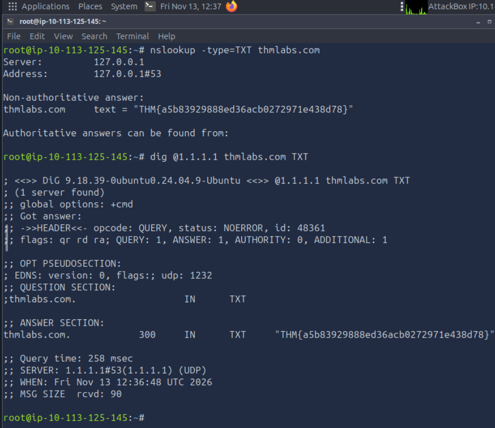

# TryHackMe: Passive Reconnaissance

**Платформа:** TryHackMe  
**Сложность:** Easy  
**Дата:** 13.11.2026

## 1. Описание комнаты

Комната посвящена пассивной разведке (Passive Reconnaissance). В отличие от активного сканирования (например, Nmap), пассивная разведка не отправляет пакеты напрямую на серверы цели. Мы используем публичные данные и сторонние сервисы, что делает нас невидимыми для систем обнаружения вторжений цели.

## 2. WHOIS и DNS

Пассивная разведка начинается с получения базовой информации о домене.

**WHOIS:** Позволяет узнать регистратора домена, дату регистрации, контактные данные владельца и авторитетные DNS-серверы. 
*Примечание:* Многие регистраторы скрывают данные владельца через сервисы приватности.

**DNS (Domain Name System):** «Телефонная книга» интернета. Мы запрашиваем записи у публичных резолверов (например, Cloudflare `1.1.1.1` или Google `8.8.8.8`), а не у серверов цели напрямую.

### Типы DNS-записей:
*   **A:** IPv4-адрес.
*   **AAAA:** IPv6-адрес.
*   **CNAME:** Каноническое имя (псевдоним, перенаправляющий на другое имя).
*   **MX:** Почтовые серверы (отвечают за прием почты).
*   **TXT:** Текстовые записи (SPF, DKIM, DMARC, верификация домена).
*   **SOA:** Start of Authority (основной сервер имен, админ почты, серийный номер).

## 3. Инструменты: nslookup и dig

В задаче разбираются два основных инструмента для DNS-запросов. **dig** является современным стандартом и предпочтительным инструментом, так как выдает более чистый вывод и показывает TTL (время кэширования).

### Синтаксис:
*   `nslookup DOMAIN_NAME` — простой поиск.
*   `nslookup -type=TYPE DOMAIN_NAME [SERVER]` — указание типа записи и DNS-сервера.
*   `dig @SERVER DOMAIN_NAME [TYPE]` — синтаксис для dig.

### Практический пример (поиск TXT-записей):
В ходе лабы мы искали скрытые флаги в TXT-записях домена `thmlabs.com`.

**Команда через nslookup:**

`nslookup -type=TXT thmlabs.com`

