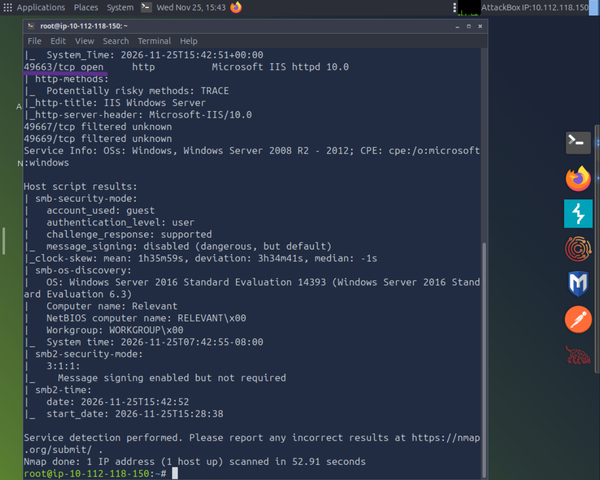

# TryHackMe: Relevant

**Платформа:** TryHackMe  
**Сложность:** Medium  
**Дата:** 25.11.2026

## 1. Описание комнаты

Relevant — это машина на Windows, которая имитирует реальный корпоративный сервер с несколькими открытыми сервисами. Задача: найти точки входа, получить первоначальный доступ и повысить привилегии до администратора. Комната отлично подходит для отработки навыков инфраструктурного пентеста на Windows.

# 2. Разведка

Первое с чего я начал - разведка. С помощью `nmap` я провел разведку: 

`nmap -p 80,135,139,445,3389,49663,49667,49669 10.112.130.106 -sC -sV `  

После я получил такой вывод:

С помощью `nmap` были обнаружены открытые порты, включая 445 (SMB) и 49663 (HTTP IIS). При проверке SMB-шар анонимным доступом была найдена шара `nt4wrksv`:

`smbclient \\\\10.112.130.106\\nt4wrksv` - без пароля.

Подключившись, я обнаружил файл `passwords.txt` 
