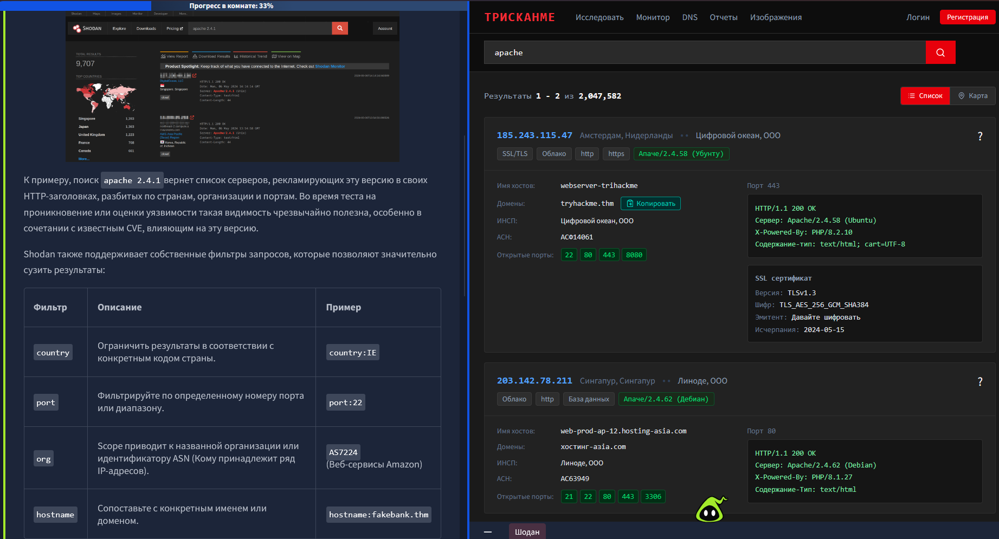
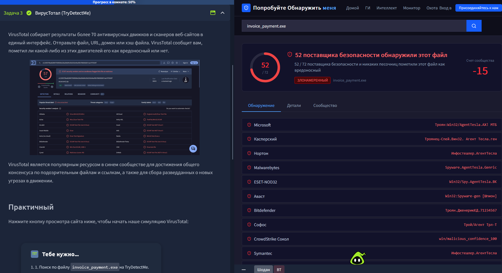
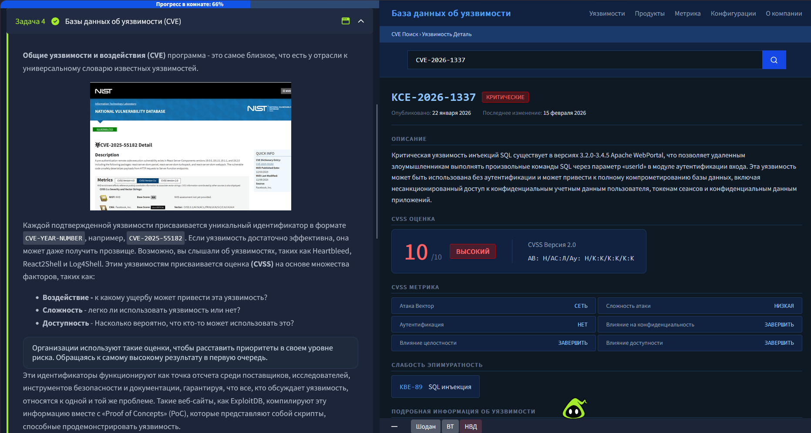

# TryHackMe: Search Skills

**Платформа:** TryHackMe  
**Сложность:** Easy  
**Дата:** 06.11.2026

## 1. Описание комнаты
Комната посвящена навыку OSINT и правильному поиску информации. В реальной работе 80% времени пентестера — это разведка (Reconnaissance). Здесь разбираются продвинутые операторы поисковых систем, поиск утечек на GitHub и специализированные базы данных.

## 2. Shodan 

Первое про что я расскажу - это **Shodan**. Shodan часто описывается как поисковая система для Интернета вещей (IoT). Шодан постоянно сканирует Интернет, ищет сетевое оборудование, промышленные системы управления, дорожные камеры и практически все остальное с подключением к сети общего пользования, чтобы увидеть, что работает и где.

## 3. VirusTotal

VirusTotal — агрегатор 70+ антивирусных движков для проверки файлов, URL и хэшей. 

**Ключевые моменты:**
- **Анализ сэмплов:** Не запускаем подозрительный файл (например, `invoice_payment.exe`) на своей машине, а сначала проверяем на VirusTotal.
- **Вердикт:** Вкладка *Detection* показывает, как угрозу классифицировали разные антивирусы (в нашем случае — инфостилер **AgentTesla**).

**Что я вынес:**
VirusTotal — база для быстрой проверки малвари. Дает первичное понимание угрозы и помогает определить семейство зловреда без запуска кода.

## 4. Базы данных об уязвимостях (CVE)

**CVE (Common Vulnerabilities and Exposures)** — это универсальный словарь идентификаторов для известных уязвимостей. Каждая получает уникальный ID в формате `CVE-ГОД-НОМЕР` (например, `CVE-2026-1337`).

**Зачем это нужно пентестеру:**
- **Оценка критичности (CVSS):** Позволяет понять, насколько опасна уязвимость. Оценка от 0 до 10 (где 10 — критическая). В нашем примере (SQL-инъекция без аутентификации) CVSS = 10.0.
- **Вектор атаки:** Метрики CVSS показывают, как атакуют (через сеть или локально), нужна ли аутентификация и каковы последствия (утечка данных, RCE).
- **Поиск эксплойтов (PoC):** Найдя CVE, можно искать готовый Proof of Concept на GitHub, в Exploit-DB или Metasploit.

**Что я вынес:**
Научился читать CVE-отчеты (например, на NVD или в базах вроде Vulners). Зная CVE и его CVSS, можно быстро приоритизировать уязвимости при пентесте и понять, какую из них ломать первой.

