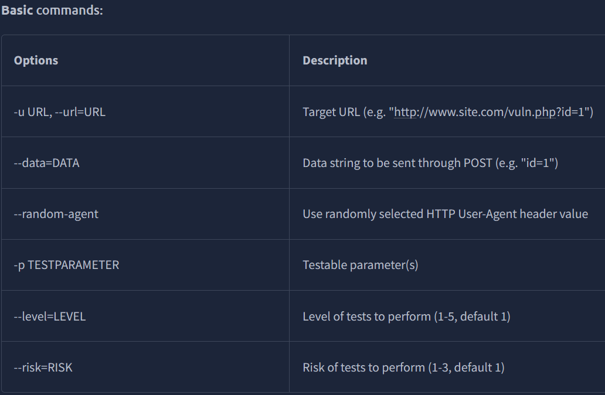
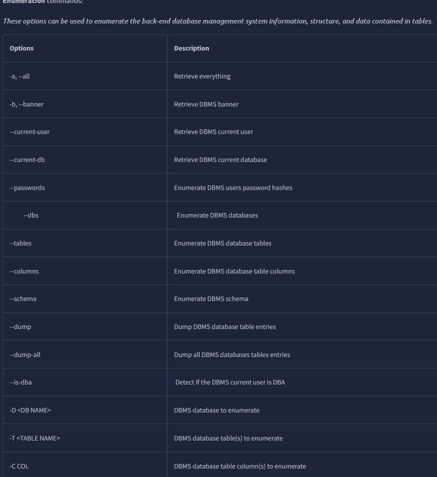
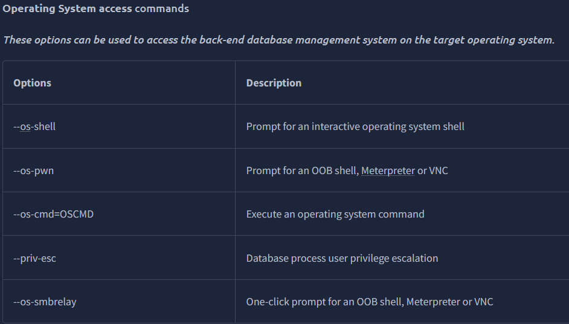

# TryHackMe: SQLMap

**Платформа:** TryHackMe  
**Сложность:** Easy  
**Дата:** 04.11.2026

## 1. Описание комнаты

Комната посвящена изучению **SQLmap** — самого популярного инструмента для автоматизации поиска и эксплуатации SQL-инъекций. 

Ранее я решал SQL-инъекции вручную на PortSwigger, поэтому здесь цель — понять, как автоматизировать этот процесс, изучить основные флаги и научиться быстро извлекать данные (базы, таблицы, пароли) из уязвимых приложений.

## 2. Основные флаги (Шпаргалка)

В ходе выполнения комнаты я изучил следующие ключевые флаги:

| Флаг | Что делает |
|:---|:---|
| `-u` | URL цели |
| `--data` | Передача данных для POST-запроса |
| `-p` | Указать конкретный параметр для атаки |
| `--dbs` | Показать список всех баз данных |
| `-D` | Выбрать конкретную базу данных |
| `-T` | Выбрать конкретную таблицу |
| `-C` | Выбрать конкретные столбцы |
| `--dump` | Вытащить данные из таблицы |
| `--sql-shell` | Открыть интерактивную SQL-оболочку |
| `--dbms` | Указать тип СУБД (например, `--dbms=MySQL`) |
| `--batch` | Автоматически отвечать на все вопросы |

---
