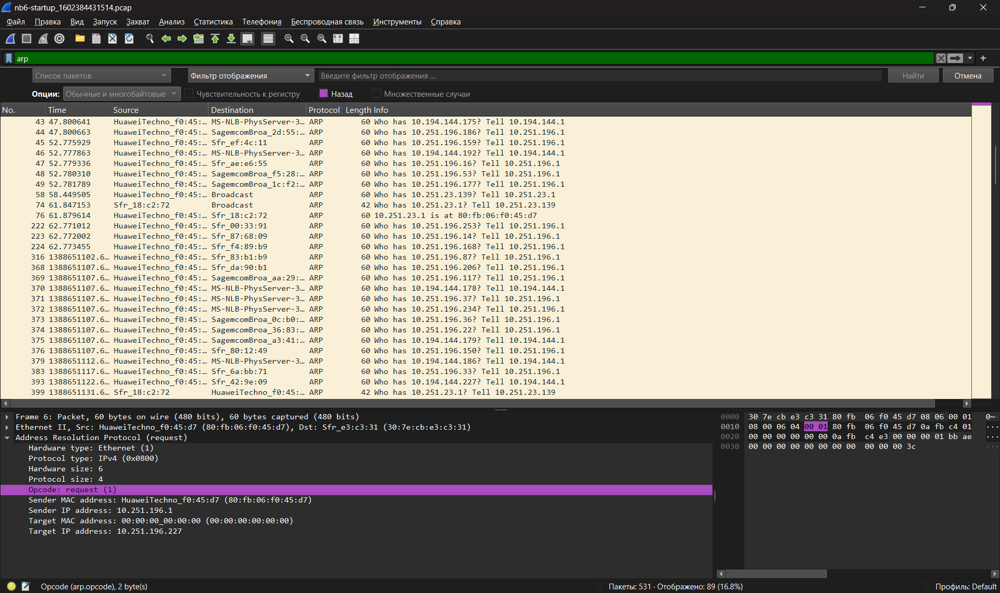
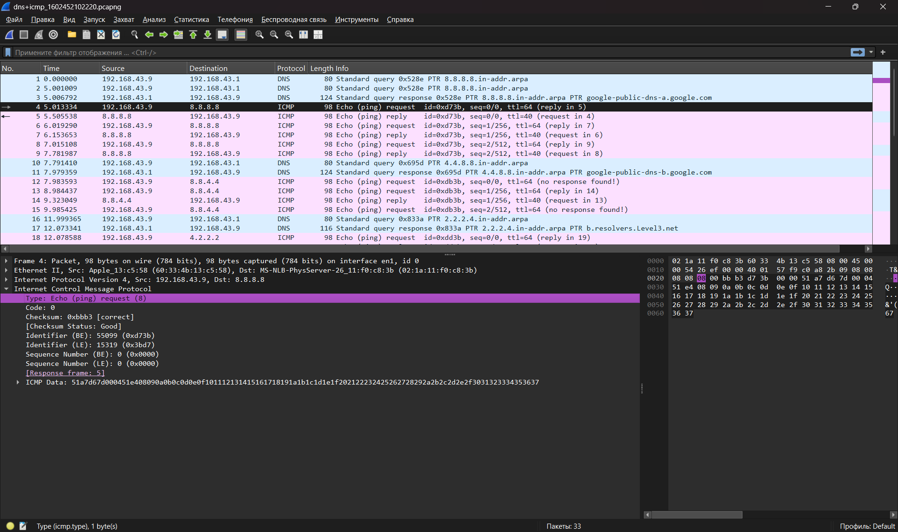

# TryHackMe: Wireshark 101 (Part 1)

**Платформа:** TryHackMe  
**Сложность:** Easy  
**Дата:** 03.11.2026

## 1. Описание комнаты
Комната посвящена изучению главного анализатора трафика - Wireshark. В первой части разбираются основы интерфейса, базовые фильтры, структура пакетов по модели OSI и анализ первых протоколов.

---

## 2. Ключевые возможности и интерфейс
- **Capture Filters:** захватывают только нужный трафик *до* его попадания в программу.
- **Display Filters:** фильтруют уже захваченные пакеты. Более мощный и удобный инструмент.
- **Name Resolution:** настройка (View -> Name Resolution -> Resolve Physical Addresses), которая позволяет Wireshark показывать имена производителей устройств вместо сухих MAC-адресов.

---

## 3. Операторы фильтрации
Для анализа больших дампов (100 000+ пакетов) критически важно уметь фильтровать.
- **Логические операторы:** `and` (&&), `or` (||), `not` (!).
- **Сравнение:** `eq` (==), `ne` (!=), `gt` (>), `lt` (<).
- **Операторы поиска:** `contains` (поиск подстроки в пакете), `matches` (поиск по регулярному выражению).

**Примеры базовых фильтров:**
- `ip.addr == 192.168.1.1` (весь трафик с этим IP).
- `ip.src == 192.168.1.1 and ip.dst == 10.0.0.1` (строго от источника к получателю).
- `tcp.port == 80 or dns` (HTTP-трафик и DNS-запросы).
- `frame contains "password"` (поиск слова "password" во всех байтах пакета).

---

## 4. Структура пакета и модель OSI
При клике на пакет Wireshark показывает его "анатомию" по уровням OSI:
1. **Frame (Layer 1):** физический уровень (размер пакета, время прибытия).
2. **Ethernet II (Layer 2):** канальный уровень (MAC-адреса отправителя и получателя).
3. **IPv4 (Layer 3):** сетевой уровень (IP-адреса).
4. **TCP/UDP (Layer 4):** транспортный уровень (порты).
5. **Application (Layer 7):** прикладной уровень (сами данные: HTTP, DNS, ARP).

---

## 5. Что я вынес
Разобрался, как работают фильтры Wireshark и понял, что настройка Name Resolution экономит время при анализе MAC-адресов. Научился читать структуру пакета, чтобы быстро находить нужные данные (например, User-Agent или запросы к DNS).

---

# 6. Практический анализ ARP

ARP (Address Resolution Protocol) — это протокол, который связывает IP-адреса с физическими MAC-адресами в локальной сети.

**Как быстро отличить Request от Reply в Wireshark:**
- В колонке `Info` запрос выглядит так: `Who has 10.251.196.1? Tell 10.251.196.227` (Кто имеет IP? Скажите отправителю).
- Ответ выглядит так: `10.251.196.1 is at 80:fb:06:f0:45:d7` (IP находится по такому-то MAC).

**Анализ пакетов:**
1. Чтобы найти все пакеты с ответами (Reply), я использовал фильтр `arp.opcode == 2`. 
2. Чтобы узнать, кому принадлежит MAC-адрес `80:fb:06:f0:45:d7`, я ввел фильтр `arp.src.hw_mac == 80:fb:06:f0:45:d7` и посмотрел в поле `Sender IP address`.

**Что я вынес:**
Понял, как работает ARP-разрешение адресов. В реальном пентесте ARP используется для атак типа ARP-spoofing (подмена MAC-адреса), чтобы перехватить трафик в локальной сети.

---

# 7. Анализ ICMP (Ping)

ICMP (Internet Control Message Protocol) используется для диагностики сети и проверки доступности узлов (самый частый пример — команда `ping`).

**Как отличить запрос от ответа:**
- **Type 8** — Echo (ping) request (запрос).
- **Type 0** — Echo (ping) reply (ответ).

**Важные детали пакета:**
- **Timestamp:** Позволяет узнать точное время отправки/получения пакета (полезно для вычисления задержек).
- **Data:** Случайные данные (обычно просто "мусор" для заполнения пакета, но иногда злоумышленники используют его для скрытой передачи данных).

**Что я вынес:**
Аномальные значения Type (не 0 и не 8) или Code могут указывать на подозрительную активность (например, туннелирование трафика через ICMP). В Red Team ICMP часто используется для скрытой передачи данных (ICMP-туннели) или разведки.

