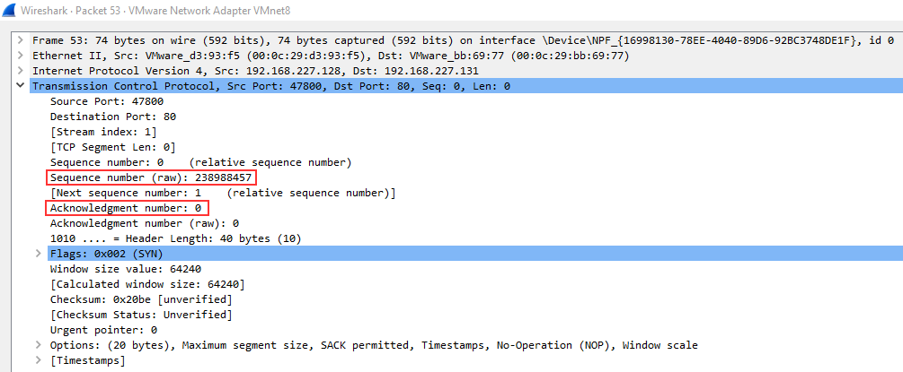
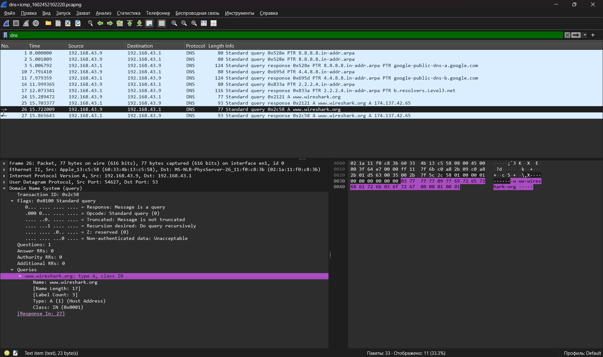
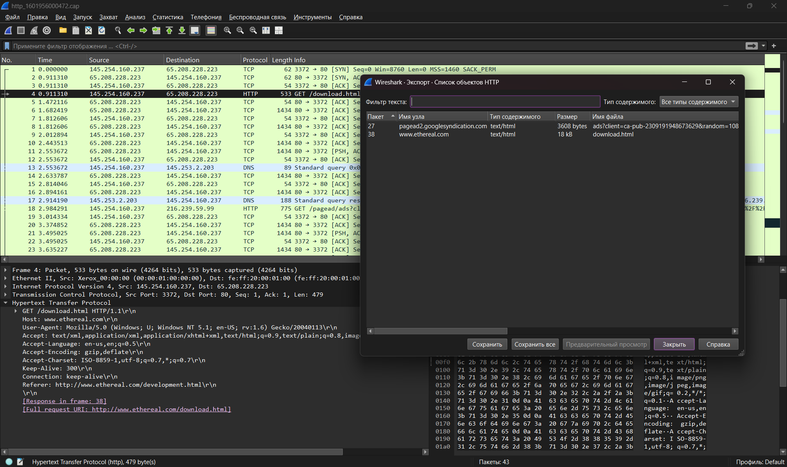

# TryHackMe: Wireshark 101

**Платформа:** TryHackMe  
**Сложность:** Easy  
**Дата:** 03.11.2026

## 1. Описание комнаты
Комната посвящена изучению главного анализатора трафика - Wireshark. В первой части разбираются основы интерфейса, базовые фильтры, структура пакетов по модели OSI и анализ первых протоколов.

---

## 2. Ключевые возможности и интерфейс
- **Capture Filters:** захватывают только нужный трафик *до* его попадания в программу.
- **Display Filters:** фильтруют уже захваченные пакеты. Более мощный и удобный инструмент.
- **Name Resolution:** настройка (View -> Name Resolution -> Resolve Physical Addresses), которая позволяет Wireshark показывать имена производителей устройств вместо сухих MAC-адресов.

---

## 3. Операторы фильтрации
Для анализа больших дампов (100 000+ пакетов) критически важно уметь фильтровать.
- **Логические операторы:** `and` (&&), `or` (||), `not` (!).
- **Сравнение:** `eq` (==), `ne` (!=), `gt` (>), `lt` (<).
- **Операторы поиска:** `contains` (поиск подстроки в пакете), `matches` (поиск по регулярному выражению).

**Примеры базовых фильтров:**
- `ip.addr == 192.168.1.1` (весь трафик с этим IP).
- `ip.src == 192.168.1.1 and ip.dst == 10.0.0.1` (строго от источника к получателю).
- `tcp.port == 80 or dns` (HTTP-трафик и DNS-запросы).
- `frame contains "password"` (поиск слова "password" во всех байтах пакета).

---

## 4. Структура пакета и модель OSI
При клике на пакет Wireshark показывает его "анатомию" по уровням OSI:
1. **Frame (Layer 1):** физический уровень (размер пакета, время прибытия).
2. **Ethernet II (Layer 2):** канальный уровень (MAC-адреса отправителя и получателя).
3. **IPv4 (Layer 3):** сетевой уровень (IP-адреса).
4. **TCP/UDP (Layer 4):** транспортный уровень (порты).
5. **Application (Layer 7):** прикладной уровень (сами данные: HTTP, DNS, ARP).

---

## 5. Что я вынес
Разобрался, как работают фильтры Wireshark и понял, что настройка Name Resolution экономит время при анализе MAC-адресов. Научился читать структуру пакета, чтобы быстро находить нужные данные (например, User-Agent или запросы к DNS).

---

# 6. Практический анализ ARP

ARP (Address Resolution Protocol) — это протокол, который связывает IP-адреса с физическими MAC-адресами в локальной сети.

**Как быстро отличить Request от Reply в Wireshark:**
- В колонке `Info` запрос выглядит так: `Who has 10.251.196.1? Tell 10.251.196.227` (Кто имеет IP? Скажите отправителю).
- Ответ выглядит так: `10.251.196.1 is at 80:fb:06:f0:45:d7` (IP находится по такому-то MAC).

**Анализ пакетов:**
1. Чтобы найти все пакеты с ответами (Reply), я использовал фильтр `arp.opcode == 2`. 
2. Чтобы узнать, кому принадлежит MAC-адрес `80:fb:06:f0:45:d7`, я ввел фильтр `arp.src.hw_mac == 80:fb:06:f0:45:d7` и посмотрел в поле `Sender IP address`.

**Что я вынес:**
Понял, как работает ARP-разрешение адресов. В реальном пентесте ARP используется для атак типа ARP-spoofing (подмена MAC-адреса), чтобы перехватить трафик в локальной сети.

---

# 7. Анализ ICMP (Ping)

ICMP (Internet Control Message Protocol) используется для диагностики сети и проверки доступности узлов (самый частый пример — команда `ping`).

**Как отличить запрос от ответа:**
- **Type 8** — Echo (ping) request (запрос).
- **Type 0** — Echo (ping) reply (ответ).

**Важные детали пакета:**
- **Timestamp:** Позволяет узнать точное время отправки/получения пакета (полезно для вычисления задержек).
- **Data:** Случайные данные (обычно просто "мусор" для заполнения пакета, но иногда злоумышленники используют его для скрытой передачи данных).

**Что я вынес:**
Аномальные значения Type (не 0 и не 8) или Code могут указывать на подозрительную активность (например, туннелирование трафика через ICMP). В Red Team ICMP часто используется для скрытой передачи данных (ICMP-туннели) или разведки.

---

# 8. TCP-трафик и тройное рукопожатие (3-Way Handshake)

TCP — это надежный протокол транспортного уровня. Прежде чем передать данные, устройства должны установить соединение. Этот процесс называется **тройным рукопожатием**.

**Как это выглядит в Wireshark (фильтр `tcp.flags.syn == 1` или просто `tcp`):**

1. **SYN (Synchronize):** Клиент отправляет пакет с флагом `SYN`, чтобы предложить установить соединение.
2. **SYN, ACK (Synchronize-Acknowledge):** Сервер отвечает пакетом с флагами `SYN` и `ACK` (соглашается и подтверждает).
3. **ACK (Acknowledge):** Клиент отправляет финальный пакет с флагом `ACK`. Соединение установлено!

**Зачем это знать пентестеру:**
- **Сканирование портов:** `nmap` (SYN-скан) отправляет только первый пакет (`SYN`) и ждет ответа (`SYN/ACK` или `RST`). Это позволяет понять, открыт порт или закрыт, не устанавливая полное соединение (Half-open scan).
- **TCP-флуд (DoS):** Атака, при которой отправляется множество `SYN`-пакетов, но соединение не завершается. Сервер тратит ресурсы на ожидание, и его память переполняется.

**Что я вынес:**
Понял, как визуально выглядит установка соединения. В Wireshark можно отследить весь путь от SYN до ACK и понять, была ли атака или это нормальный трафик.

---

# 9. Анализ DNS-трафика

DNS (Domain Name System) — это «телефонная книга» интернета. Он переводит понятные человеку доменные имена (например, `google.com`) в IP-адреса, с которыми работают компьютеры.

**На что обращать внимание при анализе DNS (Признаки аномалий):**
1. **Query-Response:** На каждый запрос (Query) должен быть ответ (Response). Если ответов слишком много или они приходят без запроса — это подозрительно (возможен DNS-спуфинг).
2. **DNS-Servers Only:** Клиенты (твои компьютеры) должны только *отправлять* запросы DNS-серверам. Если обычный компьютер начинает *отвечать* на DNS-запросы, значит, кто-то поднял фальшивый DNS-сервер (часто используется в ARP-спуфинге для перенаправления трафика).
3. **Протокол UDP:** DNS работает по протоколу UDP (порт 53). Если ты видишь DNS поверх TCP, это обычно передача зон (Zone Transfer) — частая уязвимость в конфигурации DNS-серверов.

**Практический анализ (по фильтру `dns`):**
- В пакетах можно увидеть **Transaction ID** (идентификатор транзакции) — он нужен, чтобы сопоставить запрос и ответ.
- Запросы типа **PTR** используются для обратного разрешения (поиск домена по IP-адресу).

**Что я вынес:**
Понял, как работает разрешение имен. В Red Team DNS используется для сбора информации (DNS-разведка), а также для скрытой передачи данных (DNS-туннелирование), когда трафик маскируется под обычные запросы.

---

# 10. Анализ HTTP-трафика

HTTP (HyperText Transfer Protocol) — это протокол прикладного уровня, который используется для передачи данных в вебе. В отличие от DNS, он работает по протоколу **TCP** (обычно порт 80).

**Важные методы HTTP:**
- **GET** — запрос данных (например, открыть страницу).
- **POST** — отправка данных на сервер (например, форма входа, загрузка файла).

**На что смотреть в Wireshark (фильтр `http`):**
1. **Request (Запрос):** Строка запроса (например, `GET /index.html HTTP/1.1`). Здесь видно метод, путь и версию.
2. **Response (Ответ):** Статус-код (например, `HTTP/1.1 200 OK`). Коды 2xx (успех), 3xx (редирект), 4xx (ошибки клиента), 5xx (ошибки сервера).
3. **Headers (Заголовки):** Служебная информация. Здесь можно найти `User-Agent` (какой браузер), `Cookie` (сессия) или `Host` (к какому сайту обращаемся).
4. **Body (Тело):** Сами данные (HTML-код, JSON, картинки). В Wireshark можно посмотреть содержимое, кликнув правой кнопкой на пакет -> **Follow -> HTTP Stream**.

**Зачем это знать пентестеру:**
- Через HTTP передается огромное количество чувствительных данных (пароли, токены).
- Если сайт использует HTTP (а не HTTPS), весь трафик (включая логины и пароли) передается **в открытом виде**. Ты можешь просто отфильтровать его в Wireshark и прочитать.
- Анализ HTTP-заголовков помогает найти уязвимости (например, отсутствие флага `HttpOnly` у Cookie).

**Что я вынес:**
Понял, как выглядит HTTP-запрос в сыром виде. В Wireshark можно перехватить логин и пароль, если веб-сайт работает без шифрования. Это классика CTF и реального пентеста.

---

